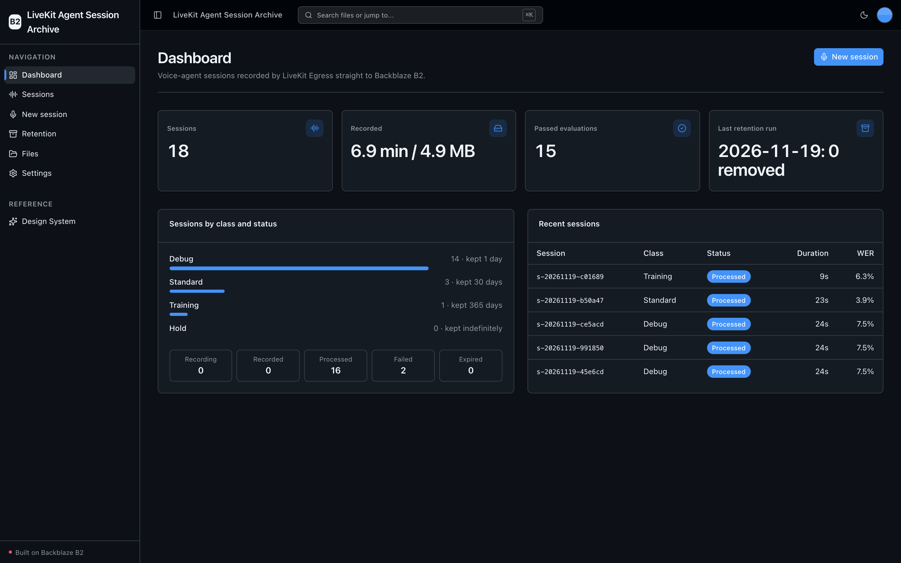
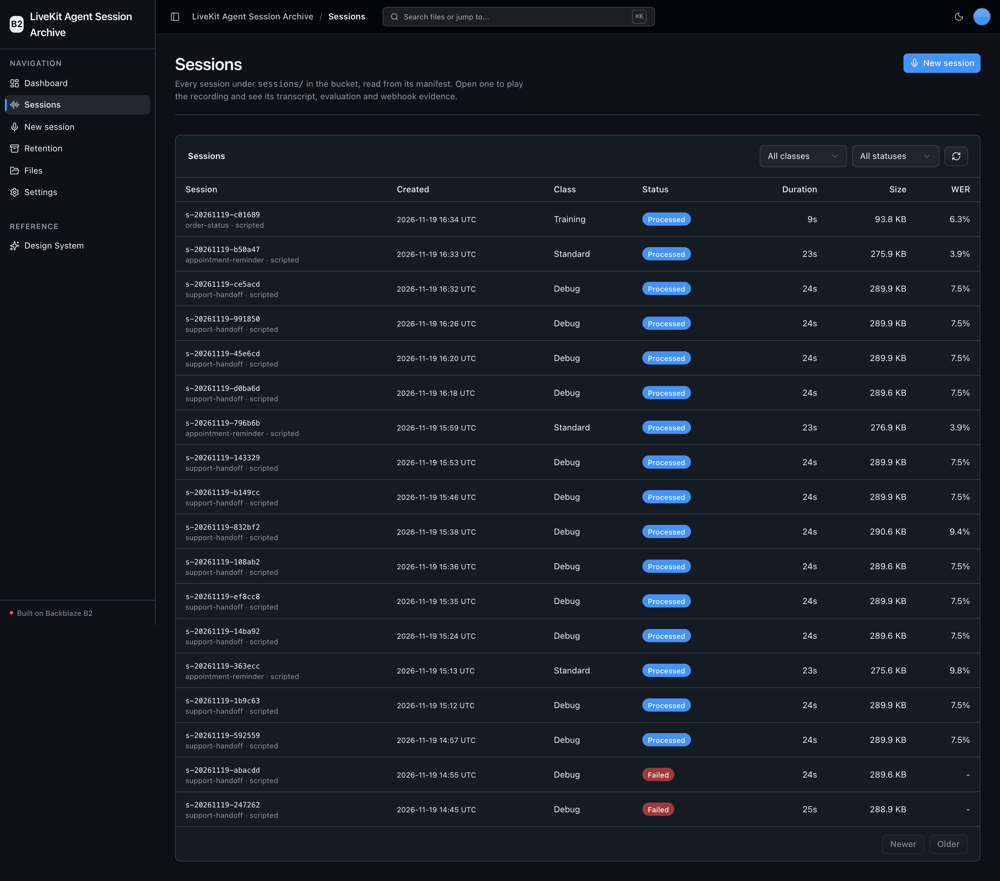
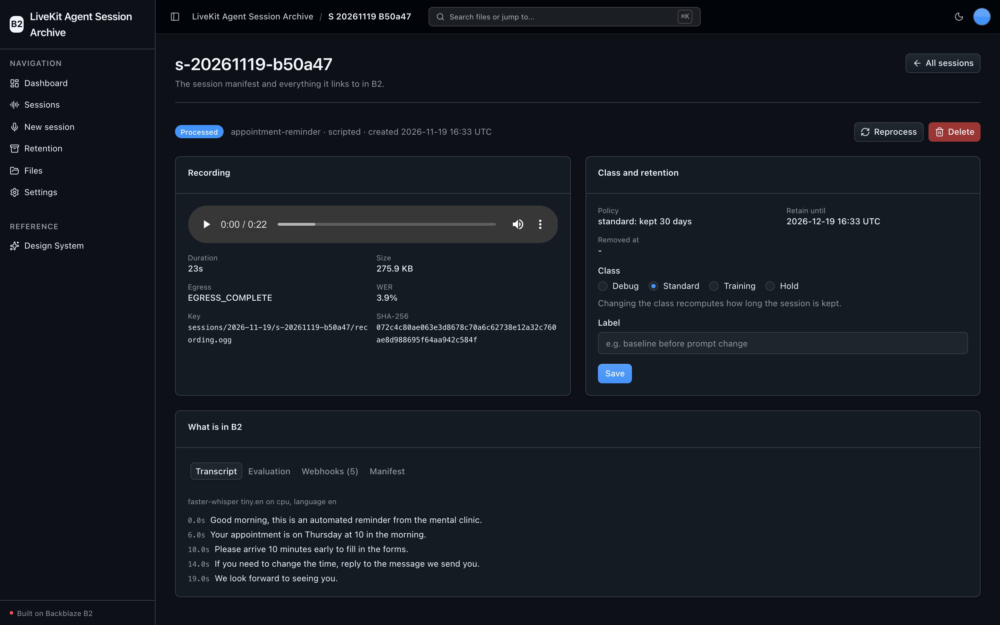
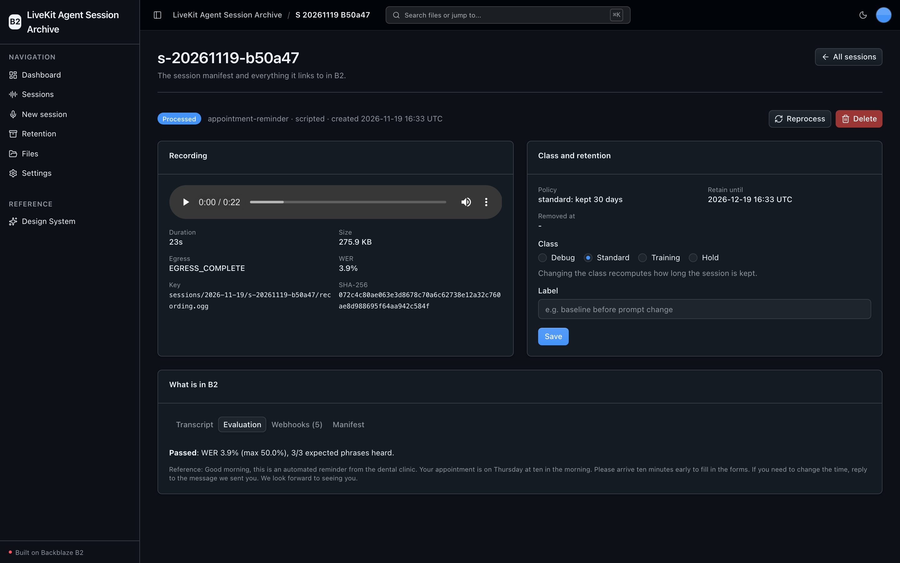
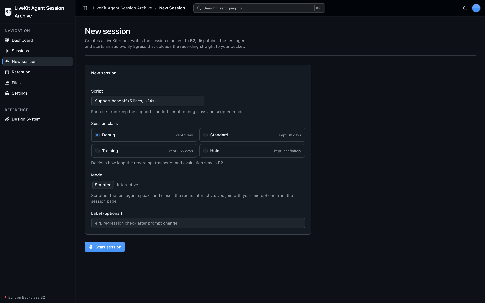
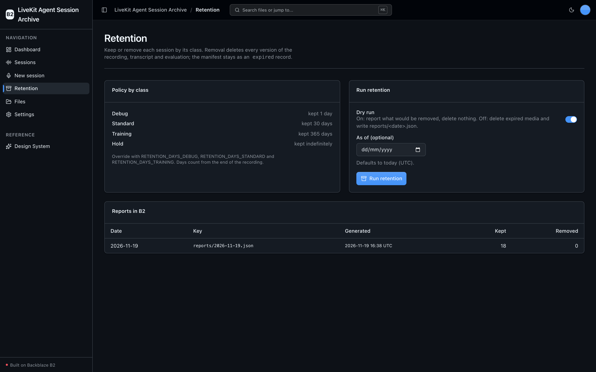

<!-- last_verified: 2026-11-19 -->
<!-- gen:begin readme-header -->
# LiveKit Agent Session Archive

LiveKit Egress recordings, manifests and retention on Backblaze B2. Record LiveKit voice-agent sessions through Egress directly to Backblaze B2, link each recording to its transcription and evaluation in a per-session manifest, and apply retention by session class.

Built for developers and AI coding agents: the scaffolding, the storage
wiring and the agent-facing docs are already done, so you start on your
app's own features instead of rebuilding the same shell. Storage is
**[Backblaze B2](https://www.backblaze.com/sign-up/ai-cloud-storage?utm_source=github&utm_medium=referral&utm_campaign=ai_artifacts&utm_content=b2ai-livekit-agent-session-archive)**, integrated through the S3-compatible API.

**What you get out of the box:**
- Full-stack dashboard UI (Next.js 16, React 19, Tailwind v4, shadcn/ui, TanStack Query, livekit-client)
- Session Recording — create a room, dispatch the test agent, and have Egress record it straight to B2
- Session Library — browse sessions under sessions/, play recordings, edit class or label, reprocess, delete
- Webhook Manifests — verified LiveKit webhooks, stored as evidence, keep each session manifest current
- Transcription and Evaluation — local faster-whisper transcript, word error rate and expected-phrase check
- Retention — keep or remove sessions by class, with a per-day report in B2
- File Browser — list, preview, download, delete any object in the bucket
- Dashboard — sessions by class and status, recorded minutes and bytes, last retention run
- Settings — theme plus labelled demo preference fields
- Backend with a strict layered architecture and structural tests (FastAPI, Python 3.12, boto3, livekit-api, faster-whisper)
- Agent-optimized docs — your AI coding agent can read the repo and start contributing immediately
<!-- gen:end readme-header -->

<!-- gen:begin readme-screenshots -->
## What it looks like

**Dashboard** — sessions, recorded minutes and bytes, passed evaluations, the last retention run, sessions by class and status, and recent sessions.



**Sessions** — every session under `sessions/` in the bucket with its script, class, status, duration, size and word error rate.



**Session detail** — the Egress recording played from B2, its key and SHA-256, the class and retention date, and the faster-whisper transcript.



**Session evaluation** — the pass or fail verdict with word error rate against the script and the expected phrases heard.



**New session** — pick a script, session class and mode, then start a LiveKit room that Egress records straight to B2.



**Retention** — the keep period per class, a dry-run or real retention run, and the daily reports stored in B2.


<!-- gen:end readme-screenshots -->

## What this sample shows

Voice agents produce evidence you need to keep: what the agent said, what the
caller heard, and whether the session met its script. This sample archives that
evidence on Backblaze B2 without a hosted model or speech provider:

1. A local LiveKit stack (server, Egress, Redis) runs in Docker Compose.
2. A minimal scripted test agent speaks in a room.
3. **LiveKit Egress writes the session recording directly to B2** with its own
   S3-compatible uploader. The API never re-uploads a recording.
4. When Egress finishes, a signed LiveKit webhook tells the API where the file
   landed. The API keeps the raw webhook as evidence and updates the session's
   `manifest.json`: location, size, duration and SHA-256 of the recording.
5. faster-whisper (`tiny.en`, local CPU) transcribes the recording and a
   deterministic evaluation scores it against the script.
6. A retention job keeps or removes each session by its class (`debug`,
   `standard`, `training`, `hold`) and writes a per-day report to B2.

It is for AI engineers running LiveKit Agents who want recordings, transcripts
and evaluation results in one durable, inexpensive, S3-compatible store, with a
retention story.

## Quick Start

You need Docker (Docker Desktop, Colima or Docker Engine with Compose v2), a free
**[Backblaze B2 account](https://www.backblaze.com/sign-up/ai-cloud-storage?utm_source=github&utm_medium=referral&utm_campaign=ai_artifacts&utm_content=b2ai-livekit-agent-session-archive)**
with a bucket and an application key, and, for the web UI, Node.js >= 20 and
pnpm >= 10.

```bash
git clone https://github.com/backblaze-b2-samples/livekit-agent-b2-session-archive.git
cd livekit-agent-b2-session-archive
cp .env.example .env        # then fill in the values below
make up                     # redis, livekit, egress, agent, api; waits until healthy
make demo                   # records one scripted session to B2, prints its manifest
```

`make demo` takes about a minute: the agent speaks a five-line script, Egress
uploads the recording when the room closes, and the API checksums, transcribes
and evaluates it. The printed manifest ends in `"status": "processed"`.

To use the UI, install the web workspace once and start it on the host:

```bash
pnpm install
make web                    # http://localhost:3000, talks to the api container on :8000
```

### Credentials

Open `.env` and fill in:

<!-- gen:begin readme-credentials -->
1. **Create a bucket** and an **application key** with `Read and Write`
   permission, then paste each value into `.env`:
   - `B2_APPLICATION_KEY_ID` — B2 application key ID (**keyID** in the B2 console); the API passes it to Egress per request
   - `B2_APPLICATION_KEY` — B2 application key (**applicationKey**), shown once at creation
   - `B2_BUCKET_NAME` — bucket unique name (**Bucket Unique Name** in the B2 console)
   - `B2_REGION` — the region inside the bucket's **Endpoint** (`s3.<region>.backblazeb2.com`); the S3 endpoint for boto3 and Egress is derived from it
   - `LIVEKIT_API_KEY` — local LiveKit dev key shared by the server, Egress, the agent and the API; any placeholder works locally
   - `LIVEKIT_API_SECRET` — local LiveKit dev secret (at least 32 characters); signs room tokens and webhooks

   B2 shows an application key once, at creation. The optional variables are
   documented in `.env.example` and in the delivery runbooks.
<!-- gen:end readme-credentials -->

`LIVEKIT_API_KEY` and `LIVEKIT_API_SECRET` are for the local LiveKit server only.
Pick any values (the secret must be at least 32 characters); the server, Egress,
the agent and the API all read the same pair from `.env`. Get the B2 values from
the [Backblaze B2 dashboard](https://secure.backblaze.com/b2_buckets.htm?utm_source=github&utm_medium=referral&utm_campaign=ai_artifacts&utm_content=b2ai-livekit-agent-session-archive);
see the docs for [creating a bucket](https://www.backblaze.com/docs/cloud-storage-create-and-manage-buckets)
and [creating app keys](https://www.backblaze.com/docs/cloud-storage-create-and-manage-app-keys).
A key restricted to one bucket with `Read and Write` is enough.

### Supported local environments

The Compose stack runs on Linux and macOS (amd64 and arm64 images exist for every
service). Local scripts run on macOS, Linux and WSL2; see
[docs/verification.md](docs/verification.md#local-environments).

## Compose topology

| Service | Image | Role | Host ports |
| --- | --- | --- | --- |
| `redis` | `redis:7.2.17-alpine` | message bus between the server and Egress | none |
| `livekit` | `livekit/livekit-server:v1.13.11` | rooms, signaling, media; sends webhooks to the API | `7880/tcp` signal, `7881/tcp` media, `50000-50019/udp` media |
| `egress` | `livekit/egress:v1.15.0` | records the room (audio only) and uploads to B2 | none |
| `agent` | built from `services/agent/` | LiveKit Agents worker that speaks the script | none |
| `api` | built from `services/api/` | REST API, webhook receiver, transcription, retention | `8000/tcp` |

All five share one bridge network. The server config is
[`infra/livekit/livekit.yaml`](infra/livekit/livekit.yaml); keys come from `.env`
as environment variables, never from the file. Egress gets its config through
`EGRESS_CONFIG_BODY` (reference copy in
[`infra/livekit/egress.yaml`](infra/livekit/egress.yaml)) and holds **no B2
credentials**: each recording request the API sends carries its own
`S3Upload`, so where recordings go is decided in audited Python code. Networking
details, including browser join from the host, are in
[infra/livekit/README.md](infra/livekit/README.md).

## How a session flows

```
POST /api/sessions
  -> create room s-<YYYYMMDD>-<6 hex>
  -> write manifest.json (status: recording)        # before anything records
  -> dispatch the test agent
  -> start audio-only room composite Egress
        filepath = <ARCHIVE_PREFIX>sessions/<date>/<room>/recording.ogg
        s3 = S3Upload(endpoint=https://s3.<B2_REGION>.backblazeb2.com, ...)
agent speaks the script, then deletes the room
Egress uploads recording.ogg to B2 and ends
LiveKit -> POST /api/webhooks/livekit (signed)       # egress_started, egress_ended
  -> verify signature on the raw body, dedupe by event id
  -> store webhooks/<event_id>.json, update manifest (status: recorded)
  -> background: head_object size check, streamed SHA-256,
     faster-whisper transcript, evaluation (status: processed)
```

### B2 layout

```
<ARCHIVE_PREFIX>sessions/<YYYY-MM-DD>/<room>/recording.ogg     # written by Egress
<ARCHIVE_PREFIX>sessions/<YYYY-MM-DD>/<room>/manifest.json     # written at session start, updated after
<ARCHIVE_PREFIX>sessions/<YYYY-MM-DD>/<room>/transcript.json
<ARCHIVE_PREFIX>sessions/<YYYY-MM-DD>/<room>/evaluation.json
<ARCHIVE_PREFIX>sessions/<YYYY-MM-DD>/<room>/webhooks/<event_id>.json   # raw verified webhook evidence
<ARCHIVE_PREFIX>reports/<YYYY-MM-DD>.json                      # retention report
```

`ARCHIVE_PREFIX` is empty by default. The `/files` page browses the whole bucket;
`/sessions` is scoped to `sessions/`.

### Manifest

Every session has one from the moment it is created. Retention never deletes it.

```json
{
  "schema_version": 1,
  "session_id": "s-20261119-a1b2c3",
  "date": "2026-11-19",
  "session_class": "standard",
  "script_id": "support-handoff",
  "mode": "scripted",
  "label": "",
  "status": "processed",
  "created_at": "2026-11-19T09:00:00Z",
  "error": null,
  "egress": {
    "egress_id": "EG_xxxxxxxx",
    "status": "EGRESS_COMPLETE",
    "started_at": "2026-11-19T09:00:02Z",
    "ended_at": "2026-11-19T09:00:24Z",
    "error": null,
    "webhook": {
      "event_id": "EV_xxxxxxxx",
      "event": "egress_ended",
      "received_at": "2026-11-19T09:00:25Z",
      "evidence_key": "sessions/2026-11-19/s-20261119-a1b2c3/webhooks/EV_xxxxxxxx.json"
    }
  },
  "recording": {
    "key": "sessions/2026-11-19/s-20261119-a1b2c3/recording.ogg",
    "location": "https://s3.<region>.backblazeb2.com/<bucket>/sessions/2026-11-19/s-20261119-a1b2c3/recording.ogg",
    "filename": "sessions/2026-11-19/s-20261119-a1b2c3/recording.ogg",
    "size_bytes": 182344,
    "duration_s": 21.4,
    "sha256": "<64 hex>",
    "etag": "<etag>",
    "content_type": "audio/ogg"
  },
  "transcription": { "key": ".../transcript.json", "model": "faster-whisper tiny.en", "device": "cpu", "language": "en", "word_count": 58 },
  "evaluation": { "key": ".../evaluation.json", "wer": 0.12, "expected_phrases_found": 4, "expected_phrases_total": 4, "passed": true },
  "retention": { "session_class": "standard", "retain_days": 30, "retain_until": "2026-12-19T09:00:24Z", "removed_at": null }
}
```

`duration_s` comes from Egress `file_results[0].duration` (int64 nanoseconds,
serialized as a string in protobuf JSON). The size is cross-checked with
`head_object`.

### Retention classes

| Class | Kept for | Override |
| --- | --- | --- |
| `debug` | 1 day | `RETENTION_DAYS_DEBUG` |
| `standard` | 30 days | `RETENTION_DAYS_STANDARD` |
| `training` | 365 days | `RETENTION_DAYS_TRAINING` |
| `hold` | indefinitely | none |

Days count from the end of the recording. A session is removed when its
`retain_until` falls on or before the as-of date (UTC). Removal deletes **every
version** of the recording, transcript and evaluation (`list_object_versions` +
`delete_object(VersionId=...)`), so the bytes are gone rather than hidden behind
a delete marker, then marks the manifest `expired` with `retention.removed_at`.
The manifest and webhook evidence stay. Run it from `/retention`, from the API,
or with:

```bash
make retention                    # dry run as of today
make retention AS_OF=2026-12-31   # dry run as of a date
make retention-apply              # delete and write reports/<date>.json
```

## Tests

`pnpm verify` is the credential-free gate (no Docker, no B2, no model). It
breaks down into `pnpm check:agent-docs`, `pnpm verify:api` (ruff, pytest,
structural tests) and `pnpm verify:web` (generator drift, ESLint, Vitest,
typecheck, Next.js build). The API tests sign real LiveKit webhook tokens with
`livekit-api` and assert a tampered body is rejected, and cover dedupe,
nanosecond conversion, retention decisions per class, the Egress request
(endpoint from `B2_REGION`, literal file path under `ARCHIVE_PREFIX`) and WER.

`make test` is the live suite. It needs `.env` with B2 credentials and Docker. It
restarts the stack with `ARCHIVE_PREFIX=e2e/<run-id>/`, creates one scripted
session, waits for `processed`, and asserts:

- the webhook was delivered (`egress.webhook` in the manifest, evidence object in B2);
- the recording exists at the manifest's key and the webhook location points at it;
- the SHA-256 of the downloaded object equals the manifest's;
- `size_bytes` equals `head_object`;
- the duration measured by decoding the file with PyAV is within 1.0 s of `duration_s`;
- the transcript and evaluation exist and the evaluation passed;
- retention: fixture sessions for all four classes with backdated end times are
  removed or kept as expected, removed ones keep an `expired` manifest, and
  `reports/<date>.json` matches the run.

It then deletes every version under `e2e/<run-id>/`.

### Human validation

Two checks need a person:

1. **Join a room.** Create an `interactive` session on `/sessions/new`, click
   "Join with microphone" on its page, talk for a few seconds, then leave.
2. **Play the recording.** When the session shows `processed`, press play on its
   page; you should hear the agent (and you, for an interactive session).

## B2 standards evidence

| Standard | Evidence |
| --- | --- |
| S3-compatible API, no b2-native calls | boto3 only, in `services/api/app/repo/`; Egress uses its built-in S3 uploader |
| Custom user agent on every S3 client the sample constructs | `services/api/app/repo/b2_client.py` sets `Config(user_agent_extra="b2ai-livekit-agent-session-archive")` on the one cached boto3 client. Egress's Go uploader (inside the `livekit/egress` image) exposes no user-agent or custom-header option: the `S3Upload` proto has `access_key`, `secret`, `session_token`, `assume_role_*`, `region`, `endpoint`, `bucket`, `force_path_style`, `metadata`, `tagging`, `content_disposition` and `proxy` only. The sample therefore tags each recording with object metadata `x-amz-meta-source: b2ai-livekit-agent-session-archive` (`services/api/app/repo/livekit_api.py`, `build_s3_upload`). |
| Standard env names | `.env.example` declares `B2_APPLICATION_KEY_ID`, `B2_APPLICATION_KEY`, `B2_BUCKET_NAME`, `B2_REGION`, `B2_PUBLIC_URL_BASE` |
| No hardcoded region | the endpoint is `https://s3.{B2_REGION}.backblazeb2.com` in `services/api/app/config/settings.py` (`endpoint_url`), used by boto3 and by every Egress request |
| UTM on Backblaze links | every backblaze.com link carries `utm_content=b2ai-livekit-agent-session-archive` |

`/b2-doctor .` on this scaffold (2026-11-19):

```
b2_native          PASS  no b2-native calls
custom_ua          PASS  1 boto3 client (services/api/app/repo/b2_client.py:41), user_agent_extra set
env_names          PASS  the five B2_* names in .env.example
env_alias          PASS  no AWS_* / B2_S3_* aliases
hardcoded_region   PASS  endpoint derived from B2_REGION
utm                PASS  every backblaze.com CTA carries utm_content=b2ai-livekit-agent-session-archive
secret_regex       PASS  no credential-shaped strings
env_undeclared     WARN  API_PORT, ARCHIVE_API_URL, RUN_LIVE_B2_TESTS, RUN_LIVE_SESSION_TESTS,
                         VERIFY_BASE_URL, WAIT_READY_TIMEOUT (dev tooling and live-test switches)
review             NOTE  Egress's built-in uploader cannot carry a user agent (see above)
```

## Pinned versions

| Component | Pin | Where |
| --- | --- | --- |
| LiveKit server | `livekit/livekit-server:v1.13.11` | `docker-compose.yml` |
| LiveKit Egress | `livekit/egress:v1.15.0` | `docker-compose.yml` |
| Redis | `redis:7.2.17-alpine` | `docker-compose.yml` |
| `livekit-agents` | `1.8.10` (pins `livekit==1.1.21`) | `services/agent/requirements.txt` |
| `livekit-api` | `1.2.2` | `services/agent/requirements.txt`, `services/api/requirements.lock` |
| `faster-whisper` | `1.2.1`, model `tiny.en` | `services/api/requirements-ml.txt` |
| `av` (PyAV) | `18.1.0` (faster-whisper 1.2.1 needs < 19) | `services/api/requirements-ml.txt` |
| `livekit-client` | `2.23.0` | `apps/web/package.json` |

Egress v1.15.0 includes the storage-library change that sends AWS SDK request
checksums only "when required" for non-AWS endpoints, which third-party S3
stores need, and records audio-only room composites through the SDK source
(no Chrome).

## Deployment

This sample runs as Docker Compose on your machine (`make up`). It needs
long-lived LiveKit, Egress and Redis containers, so it ships no serverless
deployment target.

<!-- gen:begin readme-deploy-button -->
_This app does not ship a one-click deploy button._
<!-- gen:end readme-deploy-button -->

## When to use

- You run LiveKit Agents and need every session's recording, transcript and
  evaluation in one place you can query, keep and delete by policy.
- You want Egress to write straight to S3-compatible storage and want a working,
  tested configuration for B2.
- You want a starting point for regression-testing an agent: same script, every
  run scored the same way.

## When not to use

- You need a production agent, telephony or call-center integration. The agent
  here is a scripted test fixture.
- You need compliance guarantees (legal hold, consent capture, PII redaction).
  Retention here is a cost and hygiene policy, not a compliance control.
- You want hosted speech-to-text or LLM evaluation. This sample is local only on
  purpose.

## Commands

<!-- gen:begin readme-commands -->
| Command | What it does |
| --- | --- |
| `pnpm run setup` | One-time cold start: copy `.env.example` → `.env` (only if missing), install workspace deps, create the backend venv, install locked API deps |
| `pnpm dev` | Start frontend + backend (runs the `pnpm run doctor` preflight first) |
| `pnpm wait-ready` | Block until the running web + API answer, print one line, exit 0/1 — use instead of sleeping before driving the app |
| `pnpm contract:export` | Export the FastAPI OpenAPI contract into `docs/api/openapi.json` |
| `pnpm contract:check` | Verify the exported contract and the generated client routes agree, both ways |
| `pnpm gen:api` | Regenerate the shared types, the client route registry and the query-key factory from the exported contract |
| `pnpm gen:docs` | Regenerate the marker-delimited doc regions from `docs/exec-plans/sample.json` |
| `pnpm gen:check` | Fail if any generated file or doc region is stale (first step of `pnpm verify:web`) |
| `pnpm verify` | Credential-free pre-PR suite — runs `check:agent-docs`, `verify:api`, then `verify:web` |
| `pnpm verify:full` | `pnpm verify` plus Playwright E2E; needs a live local stack, real `.env`, a free web port, and Chromium |
| `pnpm test:verify` | Run throwaway verification specs from `apps/web/e2e/verify/` against the app, with the shared browser fixtures |
<!-- gen:end readme-commands -->

| Make target | What it does |
| --- | --- |
| `make up` / `make down` | Start (and wait for) or stop the Compose stack |
| `make logs` | Follow every service's logs |
| `make demo` | Record one scripted session and print its manifest |
| `make test` | Live end-to-end suite against B2 under `e2e/<run-id>/` |
| `make retention` / `make retention-apply` | Dry-run or apply retention (`AS_OF=YYYY-MM-DD` optional) |
| `make web` | Run the Next.js UI on the host against the api container |

`pnpm verify` needs `services/api/.venv` from `pnpm run setup`, but no B2
credentials, Docker or browser. It breaks down into `pnpm verify:api`,
`pnpm verify:web` and `pnpm check:agent-docs`. Full reference:
[docs/dev-workflows.md](docs/dev-workflows.md#commands) and
[docs/verification.md](docs/verification.md).

## Core Features

<!-- gen:begin readme-core-features -->
- [Session Recording](docs/features/session-recording.md) — create a room, dispatch the test agent, and have Egress record it straight to B2
- [Session Library](docs/features/session-library.md) — browse sessions under sessions/, play recordings, edit class or label, reprocess, delete
- [Webhook Manifests](docs/features/webhook-manifests.md) — verified LiveKit webhooks, stored as evidence, keep each session manifest current
- [Transcription and Evaluation](docs/features/transcription-evaluation.md) — local faster-whisper transcript, word error rate and expected-phrase check
- [Retention](docs/features/retention.md) — keep or remove sessions by class, with a per-day report in B2
- [File Browser](docs/features/file-browser.md) — list, preview, download, delete any object in the bucket
- [Dashboard](docs/features/dashboard.md) — sessions by class and status, recorded minutes and bytes, last retention run
- [Settings](docs/features/settings.md) — theme plus labelled demo preference fields
<!-- gen:end readme-core-features -->

## Documentation Map

<!-- gen:begin readme-doc-map -->
| Doc | Purpose |
| --- | --- |
| [AGENTS.md](AGENTS.md) | Agent table of contents — start here |
| [ARCHITECTURE.md](ARCHITECTURE.md) | System layout, layering, data flows |
| [docs/features/](docs/features/) | Feature docs (session recording, session library, webhook manifests, transcription and evaluation, retention, file browser, dashboard, settings) |
| [docs/design-system.md](docs/design-system.md) | Design tokens, primitives, loader, error/empty states |
| [docs/app-workflows.md](docs/app-workflows.md) | User journeys |
| [docs/dev-workflows.md](docs/dev-workflows.md) | Engineering workflows, command index, releases |
| [docs/verification.md](docs/verification.md) | What each gate checks, and failure recovery |
| [docs/frontend-conventions.md](docs/frontend-conventions.md) | Frontend conventions, screens, data fetching |
| [docs/SECURITY.md](docs/SECURITY.md) | Security principles |
| [docs/RELIABILITY.md](docs/RELIABILITY.md) | Reliability expectations |
| [docs/api/openapi.json](docs/api/openapi.json) | The checked-in API contract the client seam is generated from |
| [docs/exec-plans/](docs/exec-plans/) | Execution plans, tech debt, and the sample manifest |
<!-- gen:end readme-doc-map -->

## FAQ

**Does the API ever upload the recording?**
No. Egress uploads it with its own S3 client. The API reads it back (streamed) to
checksum and transcribe it, and writes only the JSON documents around it.

**Why does Egress get the B2 key per request instead of in its config?**
So the destination is decided in one audited place
(`services/api/app/repo/livekit_api.py`) and the endpoint is always derived from
`B2_REGION`. The request travels over the private Compose network only.

**Does transcription use a GPU?**
`WHISPER_DEVICE=auto` uses CUDA when CTranslate2 sees a GPU, otherwise CPU.
CTranslate2 has no Apple MPS backend, so Apple Silicon runs on CPU; `tiny.en`
transcribes a 20-second session in a few seconds on a laptop CPU.

**What happens if a webhook is delivered twice?**
LiveKit retries webhooks. The API keeps recent event ids in memory and, across
restarts, treats an event whose evidence object already exists in B2 as a
duplicate. Either way the manifest is updated once.

**Can I keep a session forever?**
Change its class to `hold` on its page. Retention never removes `hold` sessions.

**Is the API authenticated?**
No. It is a local demo: anyone who can reach port 8000 can create and delete
sessions. See [docs/SECURITY.md](docs/SECURITY.md).

**Where do I get help or report bugs?**
Repository issues: [GitHub Issues](https://github.com/backblaze-b2-samples/livekit-agent-b2-session-archive/issues).
B2 account, billing or API help: [Backblaze Support](https://www.backblaze.com/help).

## Licenses

- This repository: MIT, see [LICENSE](LICENSE).
- LiveKit server, Egress, Agents, `livekit-api` and `livekit-client`: Apache-2.0.
- boto3: Apache-2.0. faster-whisper: MIT; Whisper `tiny.en` weights: MIT. PyAV: BSD-3-Clause.
- espeak-ng: GPL-3.0, installed from the Debian package and run unmodified as a
  separate program inside the agent image.
- Redis 7.2: BSD-3-Clause, run unmodified (7.2 is the last BSD-licensed line).

## Maintenance and support

Backblaze maintains this open-source sample to help developers get started with
B2. It is not covered by the Backblaze service level agreement. Report defects
through [GitHub Issues](https://github.com/backblaze-b2-samples/livekit-agent-b2-session-archive/issues).

## Related repositories

- [b2-voice-ai-reference-architectures](https://github.com/backblaze-b2-samples/b2-voice-ai-reference-architectures): reference architectures for voice AI on B2.
- [video-dubbing-b2-language-variants](https://github.com/backblaze-b2-samples/video-dubbing-b2-language-variants): speech pipelines that keep every language variant on B2.
